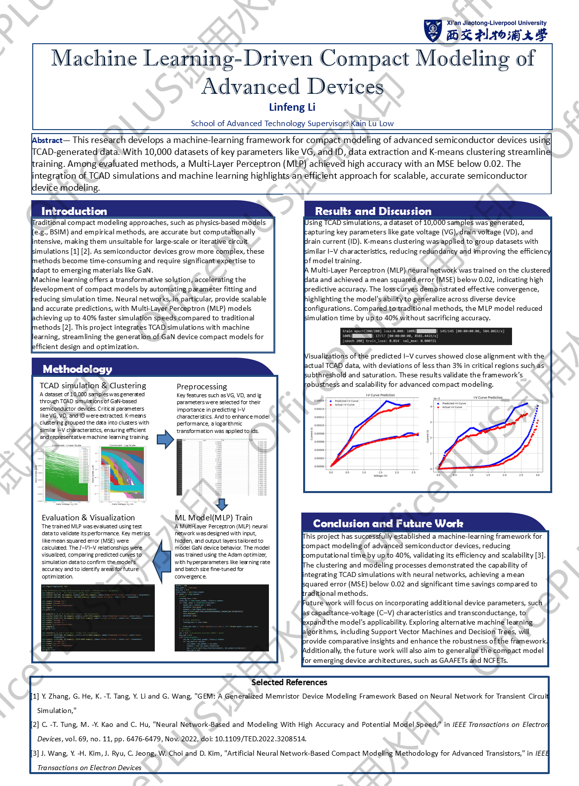

# Machine Learning-Driven Compact Modeling of GaN-Based Devices

The thesis could be found in /doc

Abstract

The increasing complexity of semiconductor devices at nanoscale has placed significant de-
mands on the accuracy and scalability of compact models used in electronic design automation.
Traditional compact modeling approaches often fall short in capturing the intricate, non-linear
characteristics of advanced devices. This thesis proposes a two-stage machine learning-driven
framework to generate compact models using TCAD-derived datasets. In the initial stage, a
baseline MLP model is implemented on a simplified dataset to verify feasibility. The second
stage extends the methodology using more complex datasets and advanced models, including
FatGCN, Random Forest, and XGBoost, with performance metrics assessed using MAE and
MSE.

Through comparative experimentation, the ensemble models demonstrated superior accuracy,
with XGBoost achieving the lowest MAE of 0.0068, while FatGCN showed potential for further
improvement through tuning. Evaluation using Id–Vg plots confirms the viability of the ML-
derived models, particularly when trained on realistic simulation data. Furthermore, the work
highlights the critical role of compact models within DTCO workflows, where precise Id–Vg
predictions contribute directly to PPAC (Power, Performance, Area, and Cost) optimization.

Although current results show promising accuracy, the research also identifies the need for
model-specific thresholds to assess industrial applicability and recommends high-performance
training for further precision gains. Overall, this thesis contributes a modular and scalable
methodology for compact modeling that supports integration into circuit simulation and semi-
conductor design pipelines.

Keywords: Compact modeling; Machine learning; TCAD simulation; ANN; XGBoost; Random
Forest

Poster below is the initial design for your reference, the actual procedure changed a lot.

